# Project Qwen

An offline home-security and assistant robot, built on salvaged hoverboard motors. It talks, follows
voice and hand-gesture commands, recognizes its owner, responds to intruders, and docks itself to recharge.

**Full write-up, with the design, the math and everything that went wrong:** https://node0x00.github.io/qwen/  
**Build video (16 min):** https://youtu.be/jL8Xb0To44A

<p align="center"><a href="https://youtu.be/jL8Xb0To44A"></a></p>

<p align="center">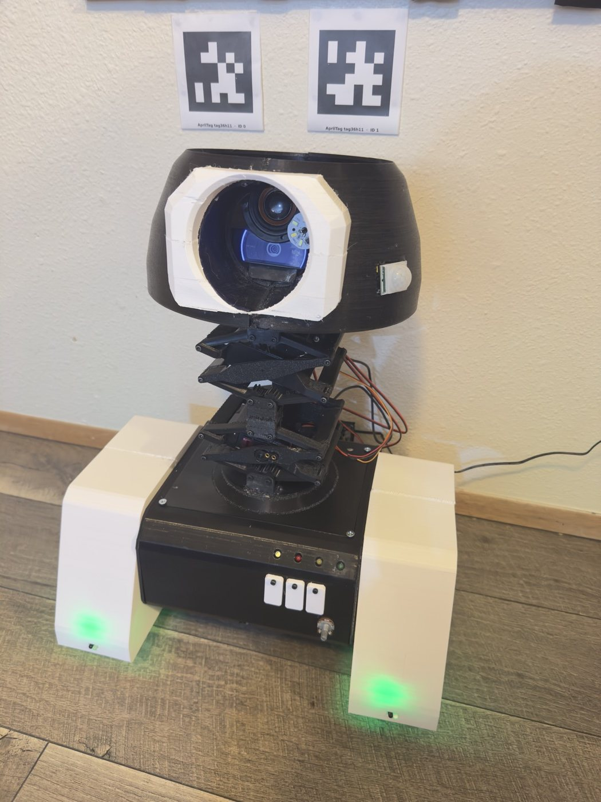</p>

## What it does

- **Voice assistant, fully offline.** Custom "Hey Qwen" wake word (openWakeWord), faster-whisper speech
  recognition, a local LLM (Qwen 2.5 1.5B via Ollama) and Piper text-to-speech, all on a Raspberry Pi 4.
- **Hand gestures** (MediaPipe Hands + geometric rules): thumbs-up records, OK stops, peace takes a photo,
  rock toggles the flashlight, an L sign locks the door.
- **Security mode.** Sleeps on a PIR motion sensor; on motion it turns on the camera, recognizes faces
  (YuNet + SFace) and people (YOLO26n), turns to keep the person in view, lights the room, warns, records,
  sounds an alarm and sends photos and video to Telegram. Disarms with the owner's face or a keypad code;
  works with an ESP32 smart-home hub (lights, door lock, keypad, remote unlock).
- **Self-docking.** Finds two AprilTags above the dock, lines up on wheel odometry, turns 180°, reverses
  onto spring contacts and confirms the dock by charging current. If it can't see the tags, it searches
  the room with monocular ORB-SLAM.
- **Power management.** Battery LEDs, "Low battery, returning to dock" at 25 %, drives off the charger at
  90 %, idle mode (everything but the motion sensor off after 2 minutes), Telegram emergency stop.

## How it's built

```
Raspberry Pi 4 (4 GB)  ── assistant.py, one process (systemd user service) ─────────────────────────
   voice · vision · security mode · docking · power manager · idle mode · control web page · Telegram
   C920 camera + mic (USB) · MAX98357A speaker (I²S) · PIR (GPIO24) · INA226 (I²C) · flashlight (GPIO23)
        │ UART 115200 (GPIO14/15 ↔ ESP32 22/21)
ESP32  ── esp32-firmware/ ────────────────────────────────────────────────────────────────────────────
   closed-loop wheel speed control on hall-sensor odometry · IR obstacle reflex · 500 ms motor watchdog
   2× ZS-X11H BLDC controllers (via level shifter) → hoverboard hub motors · 2× MG996R scissor lift · LEDs
```

The Pi decides; the ESP32 reacts. Safety reflexes live on the ESP32 so they work even if the Pi freezes.

| | |
|---|---|
| 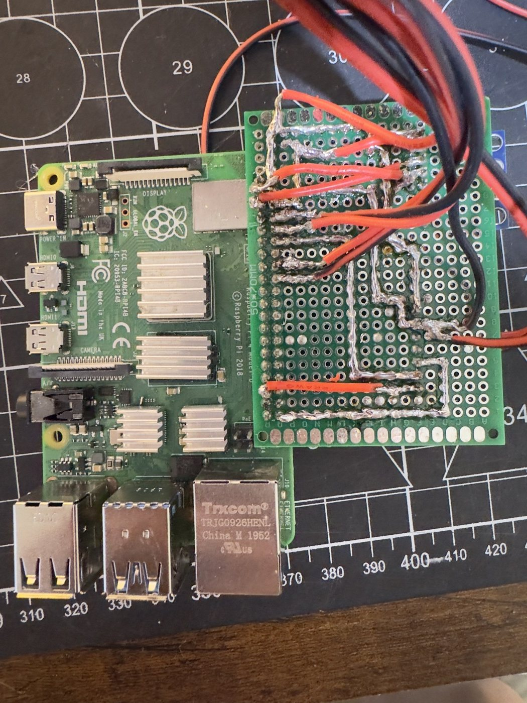 | 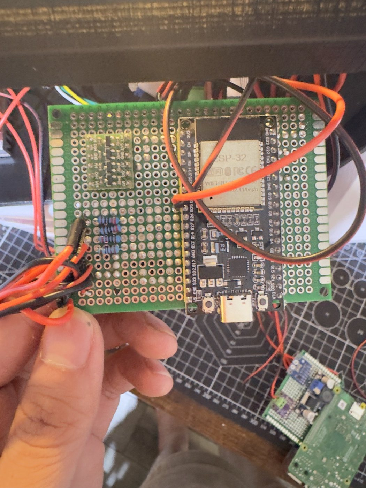 |
| Pi perfboard hat | ESP32 board, level shifter and the 10 kΩ hall dividers |

## Gallery

| | | |
|---|---|---|
| 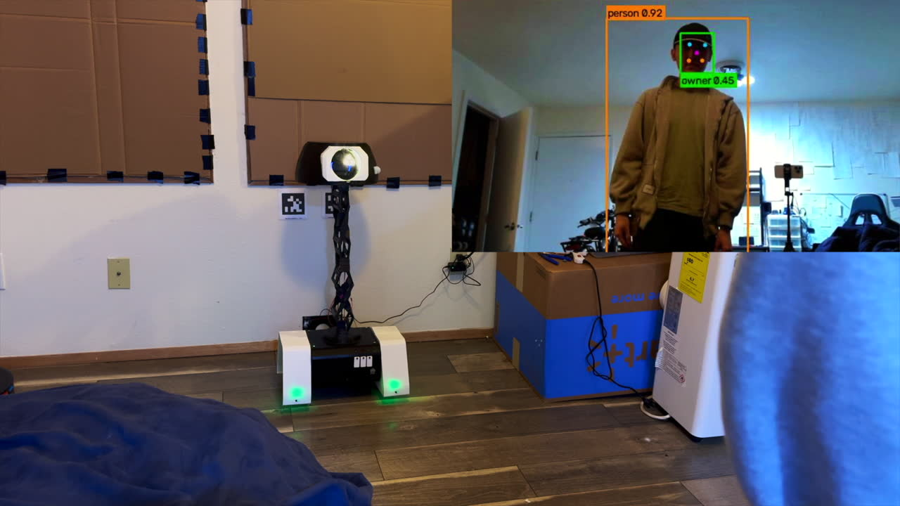 | 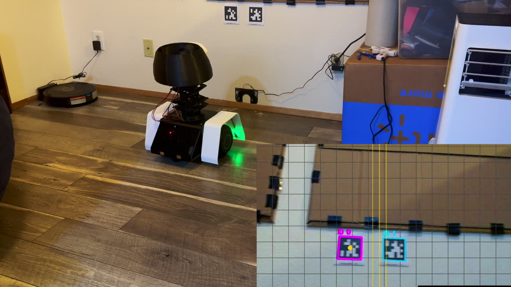 | 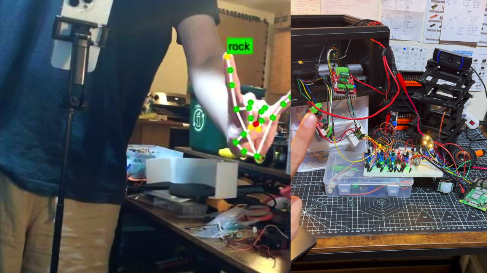 |
| Security mode tracking a person | Self-docking | Hand-gesture control |
| 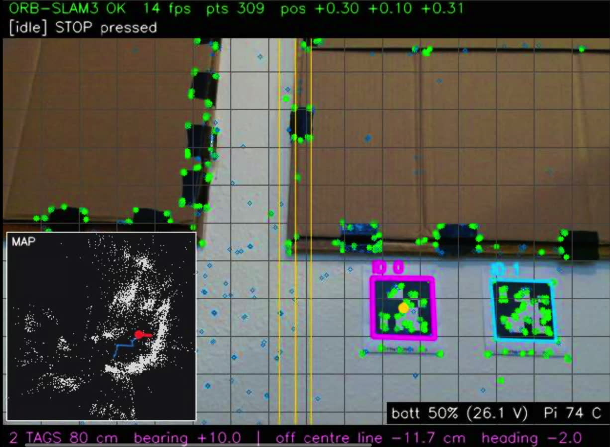 | 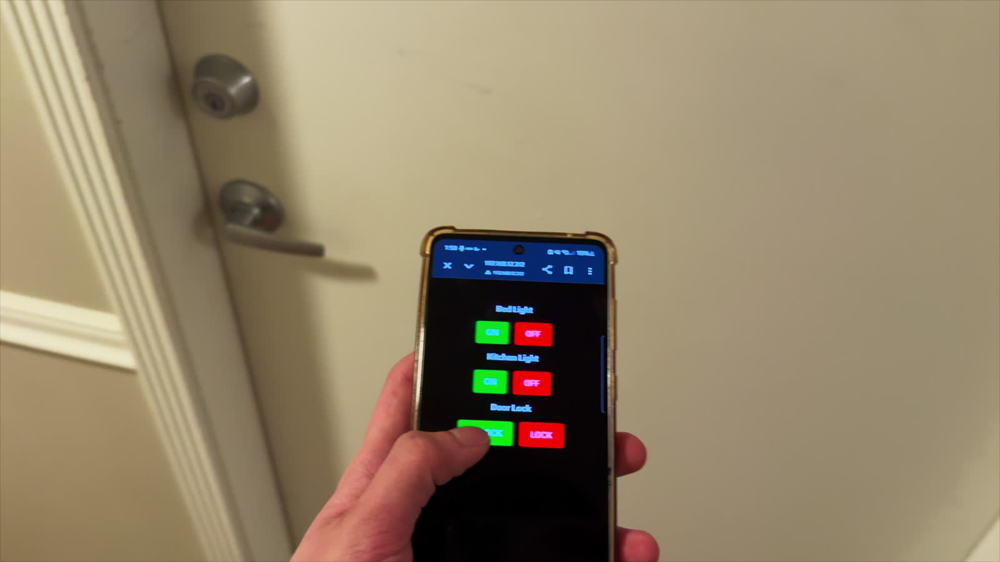 | 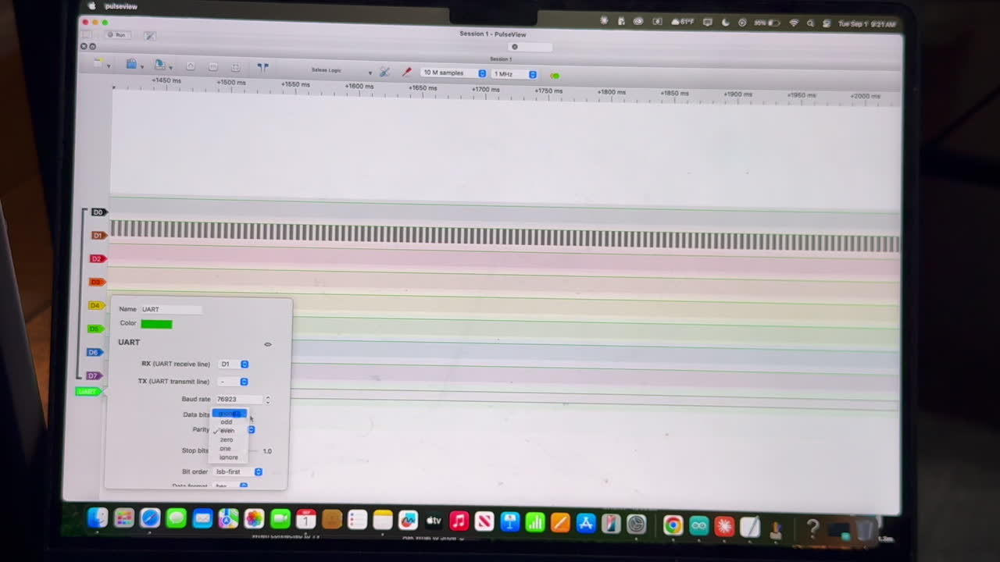 |
| What the robot sees while docking | Smart-home remote unlock | Reverse engineering the hoverboard |

**Wiring schematic** (everything as built):

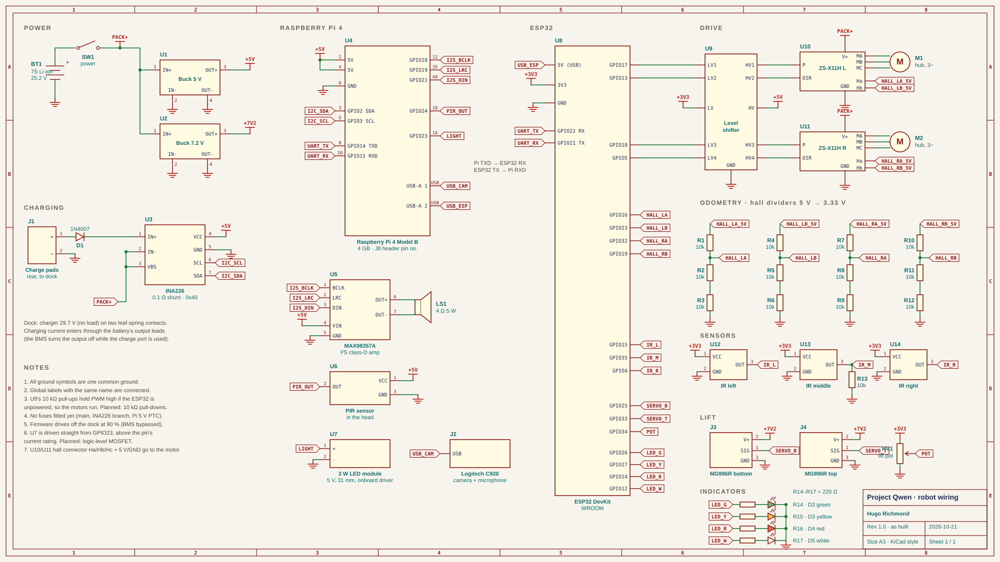

**Odometry:** distance from wheel counts, turning from the difference between the wheels:

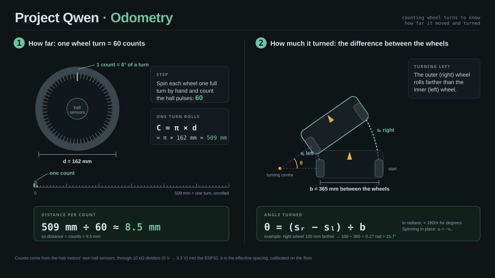

## Repository layout

| Folder | Contents |
|---|---|
| `pi/` | Robot software (Python 3.12). Entry point: `assistant.py`; service file: `qwen.service` |
| `pi/tools/` | Bench, calibration and mapping scripts used while building (`python tools/<name>.py` from `pi/`) |
| `esp32-firmware/` | PlatformIO project for the ESP32 (pins and tuning in `include/config.h`) |
| `slam/` | C++ tag tracker / ORB-SLAM3 wrapper (`mono_live.cc`), offline mapper, build script |
| `docs/` | Photos used in this README |

Key Pi modules: `robot_control.py` (driving and the four docking steps), `lost_tag_search.py`,
`security_mode.py`, `person_tracker.py`, `power_manager.py`, `sleep_mode.py`, `gesture_recognizer.py`,
`face_recognizer.py`, `object_detector.py`, `esp32_link.py`, `stream_server.py` + `slam_view.py` (control page).

## Setup (short version)

**Raspberry Pi** (Raspberry Pi OS, serial console off, I²C on):

```bash
cd pi
uv python install 3.12 && uv venv --python 3.12 venv      # mediapipe has no Python 3.13 ARM wheel
uv pip install -r requirements.txt -r requirements-pi.txt
ollama pull qwen2.5:1.5b
# models: see pi/models/README.md
cp qwen.service ~/.config/systemd/user/ && systemctl --user enable --now qwen
```

`.env` in `pi/` (never committed):

```
TELEGRAM_BOT_TOKEN=...        # from @BotFather; then `python telegram_notify.py --setup`
TELEGRAM_CHAT_ID=...
QWEN_HUB_URL=http://...       # optional smart-home hub
# QWEN_STREAM_KEY is generated on first run - the control page is http://<pi>:8080/?key=<it>
```

**ESP32:** see `esp32-firmware/README.md` (`pio run -t upload`).
**ORB-SLAM3 / tag tracker:** `slam/build_orbslam3.sh`, then build `slam/` with CMake.

## Safety notes

- The motor controllers' PWM inputs are pulled high by the level shifter, so **the motors can run at full
  speed while the ESP32 boots or is unpowered**. Lift the wheels before power-cycling or flashing.
  10 kΩ pull-downs on the PWM lines fix this and are on the to-do list.
- No fuses are fitted yet; the battery is a salvaged 7-cell Li-ion pack charged through its output leads,
  with a software stop at 90 %. Treat it with respect.

## About this project

Designed and built by Hugo Richmond, July–October 2026: hand sketches, Fusion 360, PETG prints, hand-soldered
perfboards. The scissor-lift mechanism is adapted from a Thingiverse design. I used AI assistants mainly to
speed up debugging and to draft code for subsystems I specified; the design decisions, hardware, wiring and
testing are my own.

Licensed under the MIT License (see `LICENSE`).
